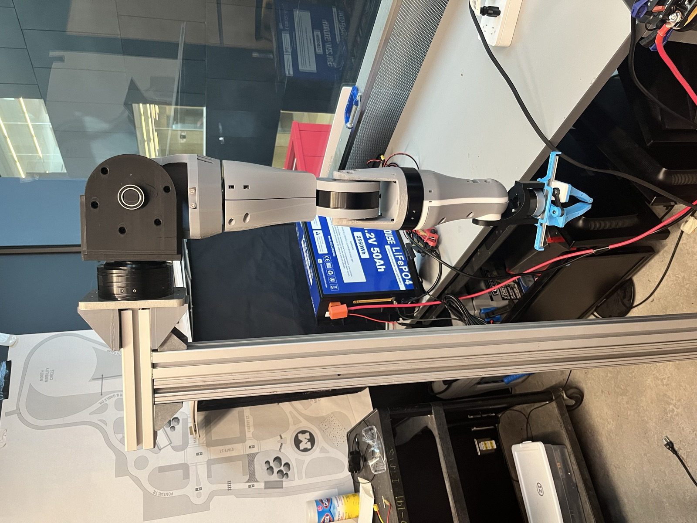
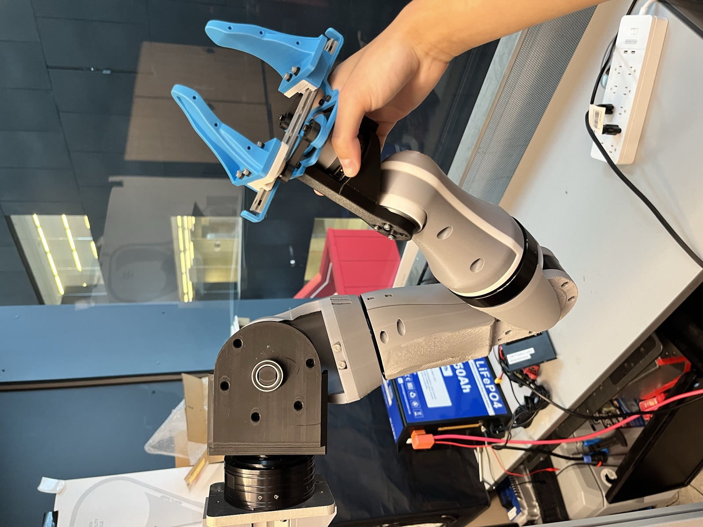
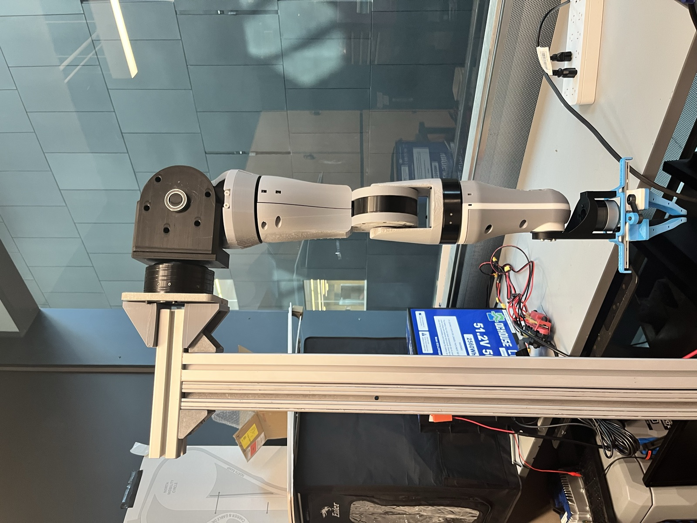
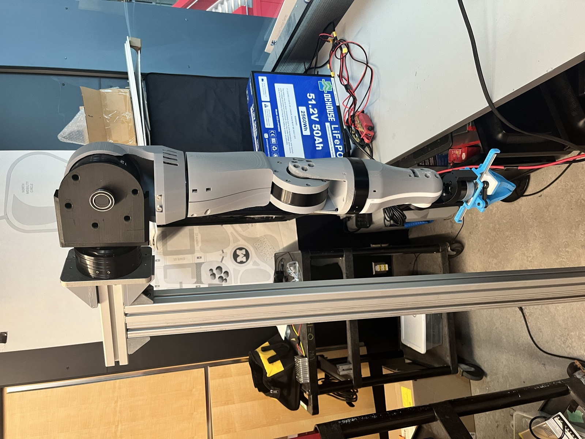
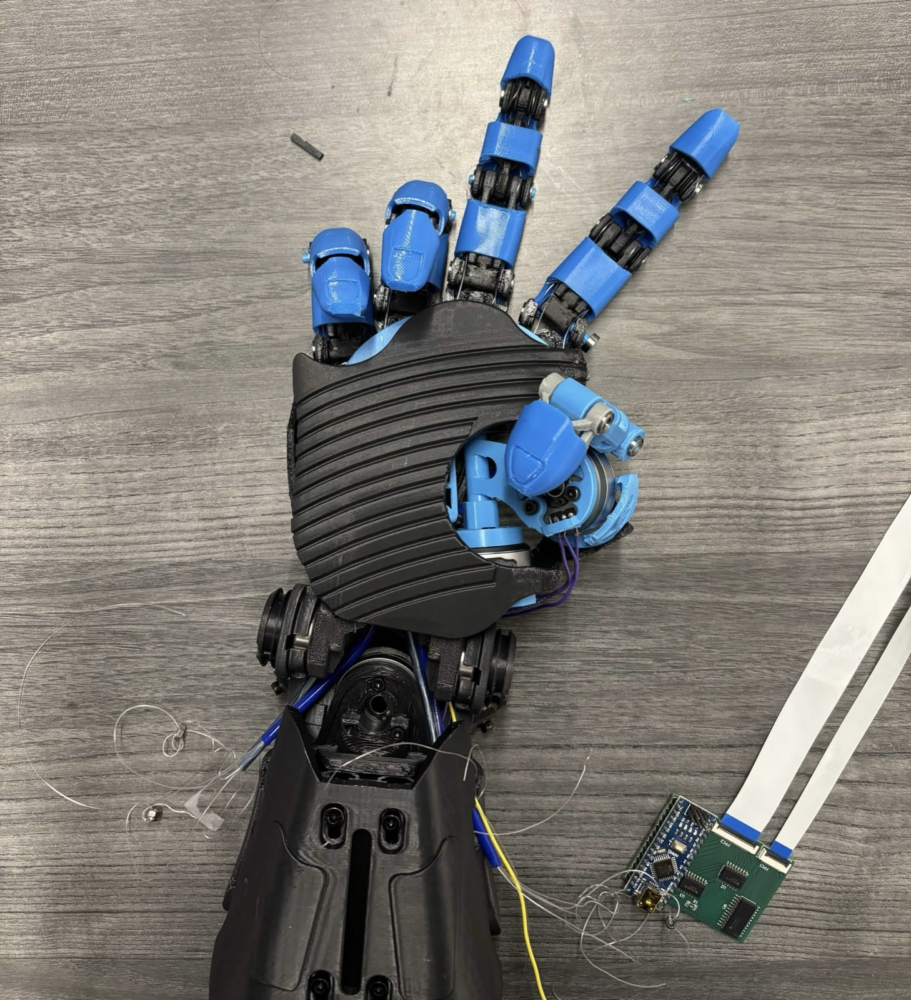

# WATonomous Humanoid Documentation


Documentation for the WATonomous Humanoid robot project at the University of Waterloo.

## Getting Started

The site lives in [`wato-humanoid-wiki/`](wato-humanoid-wiki). Pages are plain Markdown files, built into a static site by our own small generator (no Docusaurus). See [`wato-humanoid-wiki/README.md`](wato-humanoid-wiki/README.md) for how to write pages and how the site is put together.

### Setup

```bash
cd wato-humanoid-wiki
npm install
```

### Development (with hot reload)

```bash
cd wato-humanoid-wiki
npm run start
```

This will start a local server at http://localhost:3000/humanoid-docs/ that automatically rebuilds and refreshes when you make changes.

### Build (one-time)

```bash
cd wato-humanoid-wiki
npm run build
npm run serve
```






