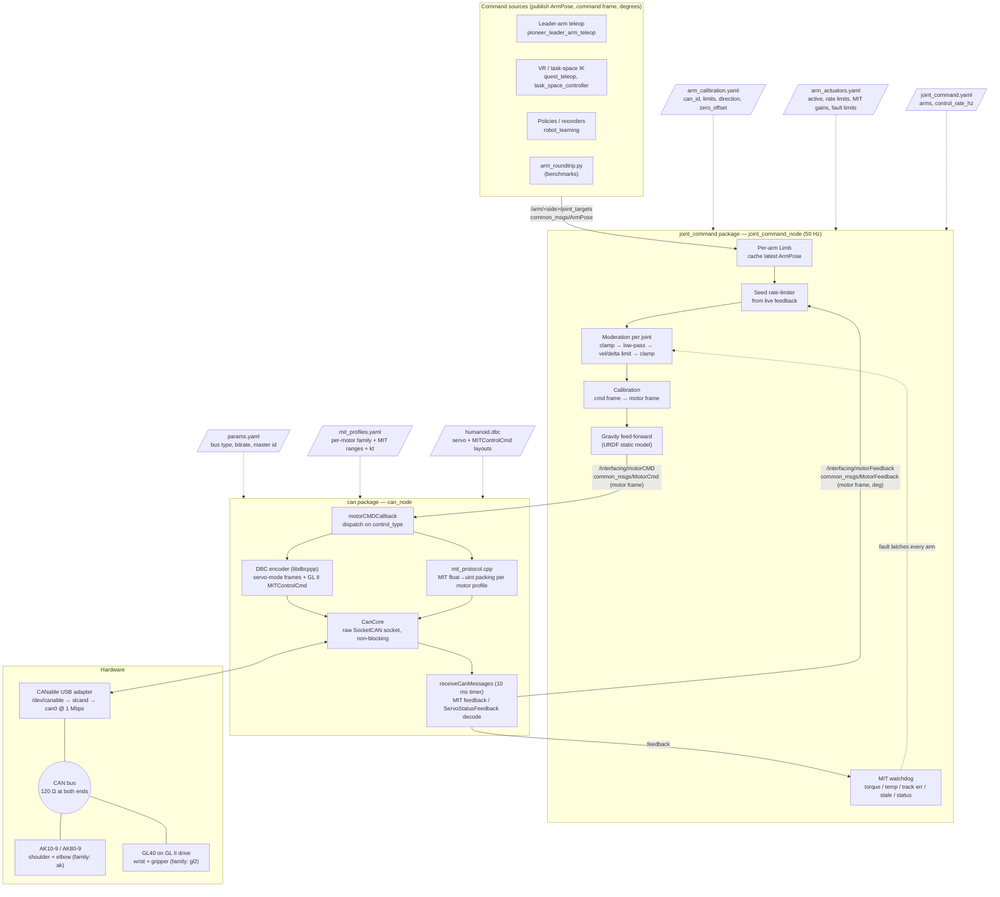
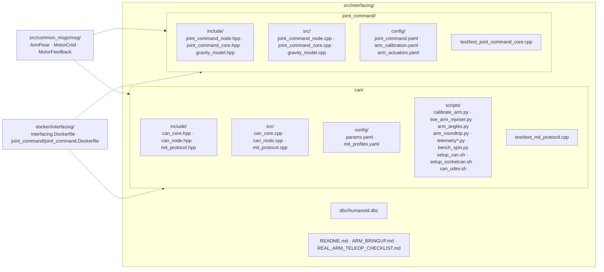
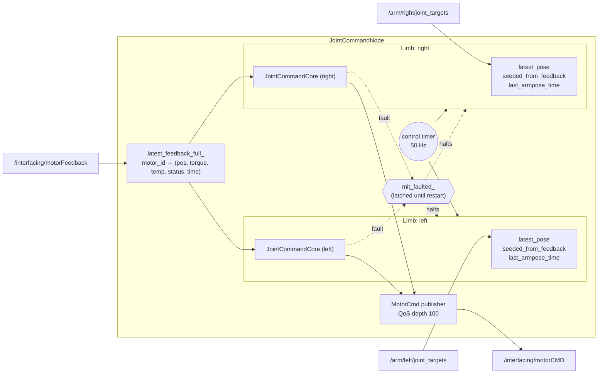
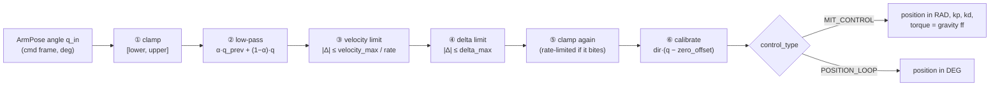
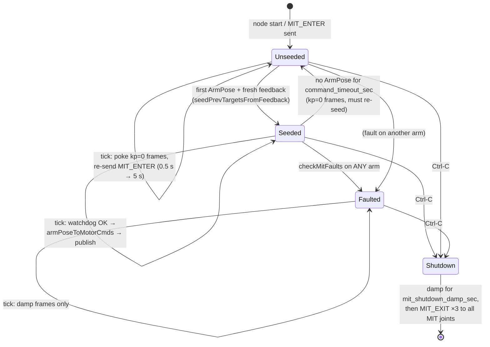
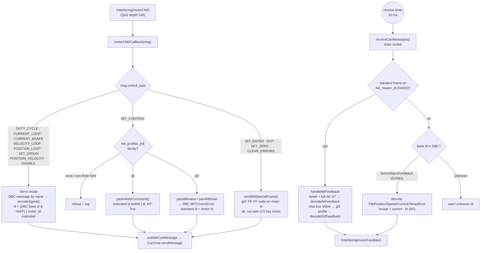
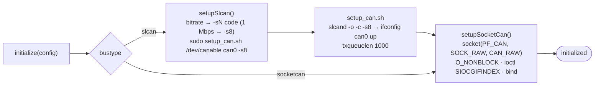
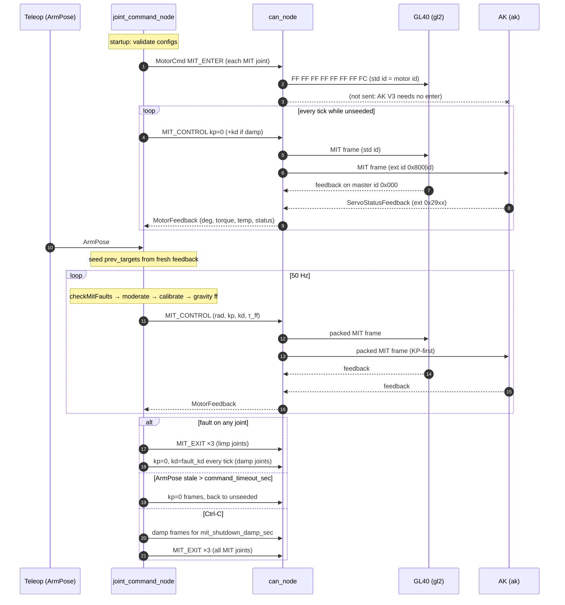
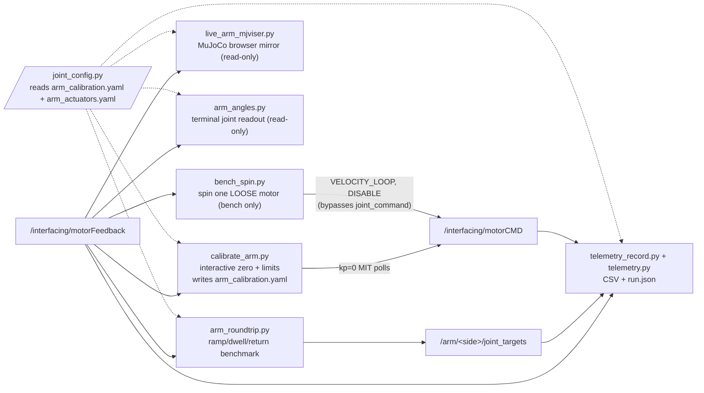
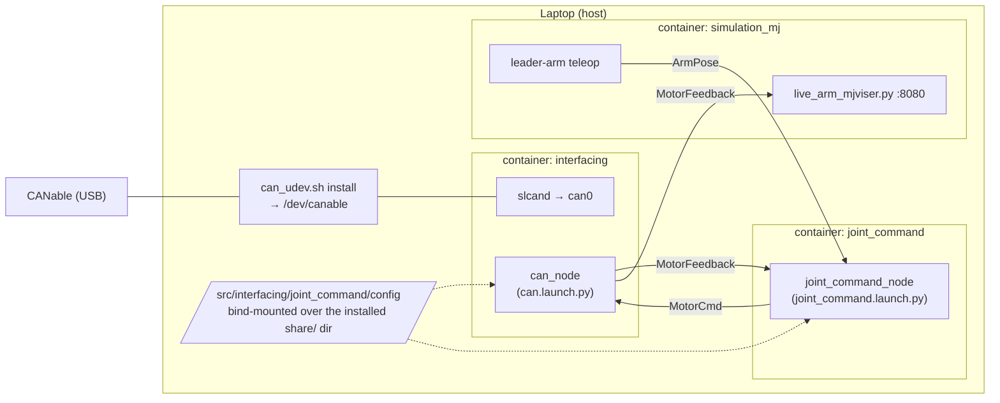

import ArmJointNaming from '@site/src/components/ArmJointNaming';

# Arm Interfacing Codebase

This page shows how the real-arm interfacing code in [`src/interfacing/`](https://github.com/WATonomous/pioneer_humanoid/tree/main/src/interfacing) fits together. It has block diagrams for the structure and pseudo-code for the main logic. The pseudo-code follows the real C++ closely but leaves out logging and boilerplate. When you need exact behaviour, read the source file named above each block.

:::tip How to read this page
Start with the [system block diagram](#1-system-block-diagram) for the big picture. Then follow one command down the stack: [`joint_command`](#4-joint_command-package) → [`can_node`](#5-can-package-can_node) → [`CanCore`](#6-cancore-linux-can-socket). The feedback path runs the other way.
:::

## 1. System block diagram

Every teleop or policy path to the real arm goes through two ROS 2 nodes. `joint_command_node` handles **safety and calibration**. `can_node` handles **wire encoding**.



| Layer | Responsibility | Does **not** do |
| --- | --- | --- |
| Command sources | Produce a desired arm pose in the command (URDF) frame | Any safety limiting |
| `joint_command_node` | Clamp, rate-limit, smooth, calibrate, add gravity feed-forward, run the MIT watchdog, manage the MIT lifecycle | Know CAN frame layouts |
| `can_node` | Turn `MotorCmd` into bytes per motor family, decode feedback into `MotorFeedback` | Any limiting (it trusts `joint_command`) |
| `CanCore` | Open, read and write a raw Linux CAN socket, and bring up SLCAN | Know about motors |

## 2. Repository map



The code is split on purpose into **ROS-free cores** and **thin ROS nodes**:

- `JointCommandCore` (`joint_command_core.cpp`) holds all moderation, calibration, seeding and watchdog logic, and has no ROS clock or publishers. `test_joint_command_core.cpp` runs it against the **shipped** YAML configs, so an unsafe config edit fails the build.
- `mit_protocol.cpp` is made of pure packing and unpacking functions, unit-tested by `test_mit_protocol.cpp` without a bus.
- `JointCommandNode` and `CanNode` only wire those cores to topics, timers and the socket.

## 3. Frames, units and messages

Most bugs on this stack come from mixing up frames or units. There are exactly two angle frames:

| Frame | Where it appears | Units | Definition |
| --- | --- | --- | --- |
| **Command frame** (= URDF frame) | `ArmPose`, joint limits in `arm_calibration.yaml`, gravity model | degrees | Zero is the arm hanging straight down. Positive follows the URDF |
| **Motor frame** | `MotorCmd.position`, `MotorFeedback.position`, the drive itself | degrees, except **radians** for `MIT_CONTROL` commands | $q_\text{motor} = \text{direction}\cdot(q_\text{cmd} - \mathtt{zero\_offset})$ |

The inverse, used for seeding and by every read-only tool, is $q_\text{cmd} = \mathtt{zero\_offset} + q_\text{motor} / \text{direction}$.

| Message | Topic | Producer → Consumer | Key fields |
| --- | --- | --- | --- |
| `ArmPose` | `/arm/<side>/joint_targets` | teleop / policy → `joint_command_node` | `is_left`, `shoulder[3]`, `elbow[2]`, `wrist[2]` (pitch, yaw), `include_gripper`, `gripper_position` (0 open .. 1 closed) |
| `MotorCmd` | `/interfacing/motorCMD` | `joint_command_node` → `can_node` | `motor_id`, `control_type` (`MIT_CONTROL=0`, `POSITION_LOOP=4`, `MIT_ENTER=9`, `MIT_EXIT=10`, …), `position`, `velocity`, `torque`, `kp`, `kd` |
| `MotorFeedback` | `/interfacing/motorFeedback` | `can_node` → `joint_command_node`, viewers, recorders | `motor_id`, `position` (deg), `velocity`, `current`, `torque` (N·m), `temperature`, `error_code` |

### 3.1 Joint naming

Every arm joint is named `<group>.<axis>`. The same names are the keys in both YAML files (`<side>: <group>: <axis>:`), so `shoulder.pitch` on the right arm is `right → shoulder → pitch` in `arm_calibration.yaml`. The ArmPose index is the joint's position in that order. Each arm uses its own CAN ids, so look those up in `arm_calibration.yaml`.

<ArmJointNaming />

| Index | Name (YAML / ArmPose) | 8-DoF URDF joint | URDF axis | Motion |
| --- | --- | --- | --- | --- |
| 0 | `shoulder.pitch` | `<side>_shoulder_pitch` | Y | Swings the arm forward / back |
| 1 | `shoulder.roll` | `<side>_shoulder_roll` | X | Lifts the arm out to the side |
| 2 | `shoulder.yaw` | `<side>_shoulder_yaw` | Z | Twists the upper arm along its length |
| 3 | `elbow.pitch` | `<side>_elbow` | Y | Bends the elbow |
| 4 | `elbow.yaw` | `<side>_forearm_roll` | Z | Twists the forearm along its length |
| 5 | `wrist.pitch` | `<side>_wrist_pitch` | Y | Tilts the hand forward / back |
| 6 | `wrist.yaw` | `<side>_wrist_yaw` | X | Swings the hand side to side |
| 7 (optional) | `gripper.open_close` | `<side>_gripper` (prismatic) | Y | 0 = open .. 1 = closed |

Axes are given for the arm hanging straight down. Signs differ between the left and right arms, so check the URDF (`assets/pioneer_bimanual_arm_8dof`). The URDF names two joints differently from the YAML: `elbow.pitch` is `<side>_elbow` and `elbow.yaw` is `<side>_forearm_roll`.

ArmPose joint order, shared by both YAML files, `joint_command_core.cpp` and `joint_config.py`:

```text
index : 0               1               2              3            4           5            6            7 (optional)
joint : shoulder.pitch  shoulder.roll   shoulder.yaw   elbow.pitch  elbow.yaw   wrist.pitch  wrist.yaw    gripper.open_close
```

:::note `wrist.yaw` comes with the dual-axis wrist motor
`wrist.yaw` is added for the dual-axis wrist motor we're about to install. Until that change lands in `joint_command`, the code still uses the 6-joint layout (no `wrist.yaw`, gripper at index 6). The pseudo-code below shows that current 6-joint code.
:::

## 4. `joint_command` package

### 4.1 Internal block diagram

One node drives **every arm** listed in `joint_command.yaml`'s `arms`. Each arm is a `Limb` with its own `JointCommandCore`, topic, seeding and stale-stream state. All arms share the feedback map, the publisher, the 50 Hz tick and the **MIT fault latch**.



### 4.2 Startup

Source: `joint_command_node.cpp` (`JointCommandNode::JointCommandNode`), `joint_command_core.cpp` (`loadFromYaml`, `loadSafetyFromYaml`, `validateMitGains`, `validateGripper`).

```text
procedure JointCommandNode.startup():
    read params: arms, control_rate_hz, control_type (default), command_timeout_sec, mit_shutdown_damp_sec
    calib  ← load share/joint_command/config/arm_calibration.yaml
    safety ← load share/joint_command/config/arm_actuators.yaml ["safety"]

    for side in arms:
        core ← new JointCommandCore
        core.loadFromYaml(calib, side)             # 6 joints (+ gripper mapping if present)
            or abort "Failed to load 6-joint mapping"
        core.loadSafetyFromYaml(safety, rate)      # global defaults, then safety.<side>
            or abort with core.lastError()         # refusing to start is deliberate

    if two arms share a motor id: abort         # feedback is matched by id alone

    limbs ← [arm for arm in loaded if arm.core.anyActive()]
    if limbs is empty: abort "No arm has an active joint"

    for limb in limbs: subscribe "/arm/<limb.side>/joint_targets" → armPoseCallback(limb)
    subscribe "/interfacing/motorFeedback" → motorFeedbackCallback
    start timer(1 / control_rate_hz) → controlTimerCallback

    for limb in limbs:                             # a GL II ignores MIT frames until entered
        publish MIT_ENTER for every active MIT joint
```

Config validation (`validateMitGains`) enforces the **startup rule**. It bounds the torque a stalled joint can produce before the tracking watchdog trips:

$$
\underbrace{\text{quantise}(k_p)\cdot \mathtt{mit\_max\_track\_err}_\text{rad}}_{\text{PD torque at the fault threshold}} + \mathtt{gravity\_ff\_max\_torque} \le \mathtt{mit\_peak\_torque}\ (\text{or } \mathtt{mit\_max\_torque})
$$

```text
procedure validateMitGains():
    for each joint i that is MIT_CONTROL:
        require mit_kp > 0 and mit_kd > 0              # kd = 0 makes a GL II oscillate
        if mit_peak_torque set: require peak ≥ mit_max_torque and mit_max_temperature set
        if mit_max_temperature set: require 0 < T ≤ 127   # MotorFeedback.temperature is int8
        kp_q   ← nearest 12-bit code of mit_kp            # what the drive actually applies
        worst  ← kp_q · deg2rad(mit_max_track_err) + (gravity_ff_max_torque if ff on else 0)
        require worst ≤ (mit_peak_torque or mit_max_torque)
        if fault_action = Damp: require 0 < mit_fault_kd ≤ 5
    for each joint with gravity_ff_scale > 0:
        require MIT, a gravity model for this side, gravity_ff_max_torque > 0, scale ≤ 5

procedure validateGripper():                     # only if the gripper block exists
    require MIT, limits [≤ 0, > 0], mit_max_track_err ≥ full travel,
            no gravity feed-forward, no mit_peak_torque
```

### 4.3 Callbacks

Callbacks only **record**. All commanding happens on the control tick, so `velocity_max` is a true per-second bound however fast `ArmPose` arrives.

```text
procedure armPoseCallback(limb, msg):
    if msg.is_left ≠ (limb.side == "left"): reject       # pose for the other arm
    if any angle non-finite: reject
    if msg.include_gripper and gripper_position non-finite: reject
    limb.latest_pose      ← msg
    limb.have_latest_pose ← true
    limb.last_armpose_time ← now

procedure motorFeedbackCallback(fb):
    latest_feedback[fb.motor_id]      ← fb.position              # motor frame, deg
    latest_feedback_full[fb.motor_id] ← (fb.position, fb.torque, fb.temperature, fb.error_code)
    latest_feedback_time[fb.motor_id] ← now
```

### 4.4 Control tick (50 Hz)

Source: `controlTimerCallback`, `readyToCommand`, `trySeedFromFeedback`.

```text
procedure controlTimerCallback():
    if mit_faulted:
        for limb: publish limb.core.mitSafeCommands(damped_only = true)   # keep AKs damped
        return

    ready ← [limb for limb in limbs if readyToCommand(limb)]
    if ready is empty: return

    samples ← latest_feedback_full with age = now − latest_feedback_time
    for limb in ready:                         # watchdog BEFORE generating new commands
        if fault ← limb.core.checkMitFaults(samples):
            mitFault("[" + limb.side + "] " + fault)
            return

    for limb in ready:
        publish limb.core.armPoseToMotorCmds(limb.latest_pose, default_control_type)
    log gravity model "pred vs meas" every 5 s

procedure readyToCommand(limb) → bool:
    if not limb.seeded:
        every 0.5 s for the first 5 s, then every 5 s:
            publish MIT_ENTER for limb's MIT joints  # first one may be lost before DDS matches
        publish limb.core.mitSafeCommands()          # kp = 0 frames: poke drives so they reply
    if not limb.have_latest_pose: return false

    if now − limb.last_armpose_time > command_timeout_sec:     # stale stream
        limb.have_latest_pose ← false
        limb.seeded ← false                       # the next ArmPose must re-seed and ramp again
        publish limb.core.mitSafeCommands()       # kp = 0: limp or damped
        return false

    return limb.seeded or trySeedFromFeedback(limb)

procedure trySeedFromFeedback(limb) → bool:
    fresh ← {id: pos for id, pos in latest_feedback if age(id) < 0.5 s}
    if fresh is empty: warn "waiting for motor feedback"; return false
    report ← limb.core.seedPrevTargetsFromFeedback(fresh)
    limb.seeded ← true
    warn for each report.unmatched joint         # no feedback → excluded until next seed
    limb.core.blockJoints(report.out_of_range)   # stale calibration → excluded
    return true
```

### 4.5 Seeding (no-slam start)

The rate limiter ramps from the previous target. If it started from an assumed 0, an arm that isn't at 0 would get a large first step, or *slam*. Seeding sets the previous target to the arm's measured pose.

```text
procedure JointCommandCore.seedPrevTargetsFromFeedback(motor_positions):
    for each ACTIVE joint i:
        if joint.motor_id not in motor_positions:
            report.unmatched += i; unpowered[i] ← true; continue
        q_motor ← motor_positions[joint.motor_id]
        prev_targets[i]       ← zero_offset + q_motor / direction    # inverse calibration
        last_motor_cmd_deg[i] ← q_motor                               # watchdog error starts at 0
        if limit_range and clamp enabled and prev_targets[i] ∉ [lower, upper]:
            report.out_of_range += i
    gravity_ff_ramp ← 0                                               # feed-forward re-ramps 0 → 1
    return report
```

### 4.6 Per-joint moderation (`armPoseToMotorCmds`)

This runs once per tick per arm and advances **one** step toward the cached pose.



```text
procedure JointCommandCore.armPoseToMotorCmds(pose, default_type) → list[MotorCmd]:
    src ← [pose.shoulder[0..2], pose.elbow[0..1], pose.wrist[0]]
    if hasGripper():
        if pose.include_gripper and finite(pose.gripper_position):
            src += clamp(pose.gripper_position, 0, 1) · gripper.upper_limit
        else:
            src += prev_targets[GRIPPER]            # hold: never drop an object

    for each joint i:
        if not active[i]: continue                  # no command at all this run
        if blocked[i]:
            if MIT: emit mitSafeCommand(i)          # kp = 0 (limp or damped)
            continue

        s ← safety[i];  q ← src[i];  q_prev ← prev_targets[i]
        if s.enable_position_clamp: q ← clip(q, lower_i, upper_i)
        if s.enable_low_pass:       q ← s.low_pass_alpha · q_prev + (1 − s.low_pass_alpha) · q
        if s.enable_velocity_limit: q ← q_prev + clip(q − q_prev, ±|s.velocity_max| / rate)
        if s.enable_delta_limit:    q ← q_prev + clip(q − q_prev, ±|s.delta_max|)
        if s.enable_position_clamp:
            q_c ← clip(q, lower_i, upper_i)
            q   ← (q_c ≠ q) ? q_prev + clip(q_c − q_prev, ±max_step) : q_c   # walk back into range

        next_targets[i]        ← q
        q_motor                ← direction_i · (q − zero_offset_i)
        last_motor_cmd_deg[i]  ← q_motor            # used by the tracking-error watchdog

        type ← (s.control_type ≥ 0) ? s.control_type : default_type
        if type = MIT_CONTROL:
            emit MotorCmd(id, MIT_CONTROL, position = deg2rad(q_motor), velocity = 0,
                          kp = s.mit_kp, kd = s.mit_kd, torque = 0 (filled below))
        else:
            emit MotorCmd(id, type, position = q_motor)          # degrees

    # gravity feed-forward: needs every joint's angle, so after the loop
    tau_motor     ← gravityTorqueMotor(next_targets)
    ff_ramp       ← min(1, ff_ramp + 1 / (rate · 1 s))
    for each emitted MIT command of joint i:
        torque ← clip(s.gravity_ff_scale · ff_ramp · tau_motor[i], ±s.gravity_ff_max_torque)

    prev_targets ← next_targets
```

### 4.7 Gravity feed-forward

Source: `gravity_model.cpp`, `JointCommandCore::gravityTorqueMotor`.

$$
\tau_\text{ff} = \operatorname{clip}\!\big(\mathtt{gravity\_ff\_scale}\cdot r \cdot \tau_\text{model}(q_\text{URDF}),\ \pm\mathtt{gravity\_ff\_max\_torque}\big),\qquad r: 0 \to 1 \text{ over } 1\,\text{s after each seed}
$$

```text
procedure gravityTorqueMotor(cmd_targets_deg) → per-joint torque (motor frame):
    for i in 0..5:
        if unpowered[i] and gravity_assume_deg set and not blocked[i]:
            q[i] ← gravity_assume_deg              # only valid while that joint is strapped there
        else if blocked[i]:
            return all zeros                       # one unknown angle → every load unknown
        else:
            q[i] ← cmd_targets_deg[i]
    tau ← (side = right) ? rightArmGravityHoldTorque(deg2rad(q))
                         : leftArmGravityHoldTorque(deg2rad(q))   # static, URDF CAD masses
    return direction_i · tau[i]                    # cmd (= URDF) frame → motor frame
```

### 4.8 MIT watchdog and fault handling

A MIT drive is a bare PD loop with no internal limit checking, so `joint_command` adds one. Source: `checkMitFaults`, `mitFault`, `exitMitJoints`.

```text
procedure JointCommandCore.checkMitFaults(samples) → fault description or none:
    for each MIT joint i that is not blocked:
        fb ← samples[motor_id_i]  or  return "no MIT feedback received at all"
        if fb.age > mit_feedback_timeout:               return "feedback stale"
        if family = ak  and fb.status ≠ 0:              return "AK error code"
        if family = gl2 and fb.status ∉ {0, 1}:         return "GL II fault status"
        if |fb.torque| > (mit_peak_torque or mit_max_torque): return "torque over hard cap"
        if mit_max_temperature set and fb.temp ≥ it:     return "over temperature"
        if |fb.torque| > mit_max_torque and no valid temperature reading:
                                                         return "over rated torque"
        if |fb.position − last_motor_cmd_deg[i]| > mit_max_track_err:
                                                         return "tracking error"
    return none

procedure JointCommandNode.mitFault(reason):           # latched until node restart
    if mit_faulted: return
    mit_faulted ← true
    log ERROR "MIT FAULT: <reason>. EVERY arm is halted"
    publish MIT_EXIT ×3 to every Limp joint of every arm   # GL40s go limp
    publish mitSafeCommands(damped_only) for every arm     # AKs: kp = 0, kd = mit_fault_kd
    # controlTimerCallback keeps re-sending the damped frames every tick: a silent AK
    # trips its own CAN timeout and drops the arm.
```

| Fault action | Frame sent | Used by | Effect |
| --- | --- | --- | --- |
| `limp` | `MIT_EXIT`, or kp = kd = 0 | `gl2` default (wrist, gripper) | Joint goes free |
| `damp` | kp = 0, kd = `mit_fault_kd` | `ak` default (shoulder, elbow) | Loaded arm sinks slowly instead of dropping |

### 4.9 Per-arm state machine



### 4.10 Shutdown

The pre-shutdown hook runs **before** the ROS context dies, because publishing after that point is silently dropped. That's why `joint_command` must be stopped **before** `can_node`.

```text
procedure shutdownMitJoints():                  # registered as rclcpp pre-shutdown callback
    cancel control timer                        # stop stiff frames toward a still-streaming teleop
    damp ← mitSafeCommands(damped_only = true) for every arm
    if damp not empty and mit_shutdown_damp_sec > 0:
        repeat at control rate for mit_shutdown_damp_sec: publish damp
    publish MIT_EXIT ×3 to every MIT joint of every arm
```

## 5. `can` package: `can_node`

### 5.1 Internal block diagram



### 5.2 Startup

Source: `can_node.cpp` (`CanNode::CanNode`, `loadMitProfiles`).

```text
procedure CanNode.startup():
    dbc ← load share/can/config/humanoid.dbc via libdbcppp
    for each message m in dbc:
        can_messages[m.name] ← m
        can_id_map[m.id − 0x80000000] ← m          # strip the DBC extended-frame flag

    loadMitProfiles()                               # share/can/config/mit_profiles.yaml
    params ← can_interface, device_path, bustype, bitrate, receive_poll_interval_ms, mit_master_id
    if CanCore.initialize(params):
        start timer(receive_poll_interval_ms) → receiveCanMessages
    subscribe  /interfacing/motorCMD     → motorCMDCallback
    advertise  /interfacing/motorFeedback

procedure loadMitProfiles():
    for (id, entry) in yaml["motors"]:
        p ← MitProfile(p/v/t/kp/kd min..max, model, kt, family ∈ {ak, gl2})
        if family unknown: skip  (MIT for this id will be refused)
        if family = ak and kt ≤ 0: warn "torque will read 0 → mit_max_torque can never trip"
        mit_profiles[id] ← p
    # GL II feedback only carries the low hex digit of the id:
    for each ak id whose (id & 0xF) equals some gl2 id's (id & 0xF):
        drop that ak profile                        # its master-id feedback would be ambiguous
```

### 5.3 Command dispatch

```text
procedure motorCMDCallback(msg):
    switch msg.control_type:
        case servo modes (DUTY_CYCLE, CURRENT_LOOP, CURRENT_BRAKE, VELOCITY_LOOP,
                          POSITION_LOOP, SET_ORIGIN, POSITION_VELOCITY, DISABLE):
            m     ← can_messages[<name for this mode>]          # e.g. "PositionLoopCmd"
            frame ← CanMessage(id = (m.id & 0xFFFFFF00) | msg.motor_id, size = m.size)
            encodeSignal(m.<signal>, msg.<field>, frame)         # DBC applies scale/offset
            send(frame)

        case MIT_CONTROL:
            p ← mit_profiles[msg.motor_id]  or  refuse "no MIT profile"
            if any of position/velocity/kp/kd/torque non-finite: refuse
            if p.family = ak:
                frame ← extended CanMessage(id = 0x800 | motor_id,
                                            data = packAkMitCommand(pos, vel, kp, kd, tau, p))
            else:  # gl2
                frame ← CanMessage(id = motor_id, standard)     # DBC MITControlCmd layout
                encode MIT_KP       ← packMitGain(kp, p.kp_max, 12)
                encode MIT_KD       ← packMitGain(kd, p.kd_max, 12)
                encode MIT_Position ← packMitValue(pos, p.p_min, p.p_max, 16)
                encode MIT_Velocity ← packMitValue(vel, p.v_min, p.v_max, 12)
                encode MIT_Torque   ← packMitValue(tau, p.t_min, p.t_max, 12)
            send(frame)

        case MIT_ENTER | MIT_EXIT | MIT_SET_ZERO | MIT_CLEAR_ERRORS:
            sendMitSpecialFrame(motor_id, 0xFC | 0xFD | 0xFE | 0xFB)

procedure sendMitSpecialFrame(id, code):
    p ← mit_profiles[id]  or  refuse
    if p.family = ak:
        if code = SET_ZERO: error "use SET_ORIGIN instead"   # AK V3 has no MIT special frames
        return
    send standard frame(id, [FF FF FF FF FF FF FF code])
```

### 5.4 MIT packing (`mit_protocol.cpp`)

The CubeMars MIT frame packs five physical values into 8 bytes as fixed-point codes. The two families use the **same field widths but different byte orders**:

```text
                byte0      byte1              byte2      byte3              byte4      byte5      byte6              byte7
GL II (gl2):    p[15:8]    p[7:0]             v[11:4]    v[3:0]|kp[11:8]    kp[7:0]    kd[11:4]   kd[3:0]|t[11:8]    t[7:0]
AK V3 (ak):     kp[11:4]   kp[3:0]|kd[11:8]   kd[7:0]    p[15:8]            p[7:0]     v[11:4]    v[3:0]|t[11:8]     t[7:0]
```

```text
function packMitValue(phys, min, max, bits):            # position, velocity, torque
    phys ← clip(phys, min, max)
    raw  ← truncate((phys − min) · 2^bits / (max − min))  # manual's float_to_uint
    return min(raw, 2^bits − 1)                          # phys = max would overflow and wrap to 0

function packMitGain(phys, max, bits):                   # kp, kd
    phys ← clip(phys, 0, max)
    return min(round(phys · 2^bits / max), 2^bits − 1)   # NEAREST code (truncation sent kp 0.61 as 0.488)

function unpackMitValue(code, min, max, bits):
    return code · (max − min) / (2^bits − 1) + min

# The drive then applies:  τ = kp·(p_des − p) + kd·(v_des − v) + τ_ff
```

### 5.5 Feedback decode

```text
procedure receiveCanMessages():                      # every receive_poll_interval_ms
    frames ← drain CanCore.receiveMessage() until it returns false
    for f in frames:
        if handleMitFeedback(f): continue            # checked first: master id 0x000 collides
                                                     # with DutyCycleCmd's DBC base id
        base ← f.id & 0xFFFFFF00;  dev ← f.id & 0xFF
        if can_id_map[base].name = "ServoStatusFeedback":       # AK, servo AND MIT mode
            fb.position    ← FbkPosition (deg)
            fb.velocity    ← FbkSpeed
            fb.current     ← FbkCurrent
            fb.torque      ← current · kt   if dev has an ak profile with kt > 0, else 0
            fb.temperature ← FbkTemperature;  fb.error_code ← FbkErrorCode
            publish fb as MotorFeedback(motor_id = dev)
        else if base unknown: warn

procedure handleMitFeedback(f) → consumed?:
    if f is extended or f.id ≠ mit_master_id or len < 8: return false
    if mit_profiles[f.data[0]] is ak:                # classic-MIT AK: byte 0 = full id
        publish decodeAkFeedback(...); return true
    nibble ← f.data[0] & 0xF                         # GL II: status<<4 | id nibble
    p ← the unique gl2 profile with (id & 0xF) = nibble   (warn if 0 or ≥ 2 match)
    fb ← decodeGl2Feedback(f.data, p)                # pos rad, vel, torque, temps, status
    publish MotorFeedback(id, position = rad2deg(fb.position), velocity, torque,
                          temperature = drive_temp, error_code = status)
    return true
```

## 6. `CanCore`: Linux CAN socket

Source: `can_core.cpp`. It's a thin wrapper around a raw, non-blocking SocketCAN socket. With `bustype: slcan`, it first runs `setup_can.sh` to turn the CANable's serial device into a `can0` network interface.



```text
procedure sendMessage(msg):
    frame.can_id ← msg.id | (CAN_EFF_FLAG if extended) | (CAN_RTR_FLAG if remote)
    frame.dlc    ← min(len(msg.data), 8)               # classic CAN only
    copy data; write(socket, frame)
    return bytes_written = sizeof(frame)

procedure receiveMessage(out msg) → bool:
    n ← read(socket, frame)                            # non-blocking
    if n < 0 and errno ∈ {EAGAIN, EWOULDBLOCK}: return false   # nothing pending
    if n < sizeof(frame): return false
    msg.is_extended ← frame.can_id & CAN_EFF_FLAG
    msg.id          ← frame.can_id & (extended ? CAN_EFF_MASK : CAN_SFF_MASK)
    msg.data        ← frame.data[0 .. dlc]
    return true
```

:::note
`can_node` does **not** reconnect. If the CANable drops off USB, `can0` disappears and every send fails. Replug the adapter and restart the `interfacing` container.
:::

## 7. MIT lifecycle, end to end



## 8. Supporting scripts

All of these live in `can/scripts/`. They share `joint_config.py`, which reads the YAML configs the same way `joint_command` does. Most are **read-only**. The ones that publish either go through `joint_command`'s safety pipeline or carry their own guards.



| Script | Publishes | Safety path |
| --- | --- | --- |
| `calibrate_arm.py` | kp = 0 MIT frames on `motorCMD`, so MIT drives answer | Joints are limp, so support the arm. Stop `joint_command` first |
| `live_arm_mjviser.py`, `arm_angles.py` | nothing | Read-only |
| `arm_roundtrip.py` | `ArmPose` | Full `joint_command` pipeline. Refuses if another publisher, a silent joint, near-limit, or stale installed configs |
| `telemetry_record.py` | nothing | Read-only. Records both `sp_raw_deg` (requested) and `sp_deg` (sent) |
| `bench_spin.py` | `VELOCITY_LOOP` + `DISABLE` on `motorCMD` | **Bypasses `joint_command`.** Its own guards: refuses arm ids, speed/time caps, always ends with `DISABLE` |

Pseudo-code of the calibration loop, the one script every session runs:

```text
procedure calibrate_arm(side, write_mapping, zero_mode = software, limit_pad = 2°):
    refuse if another node publishes /interfacing/motorCMD     # e.g. joint_command running
    start 20 Hz kp = kd = 0 MIT polls to every MIT joint       # GL40s only reply when spoken to
    for joint in arm_calibration.yaml[side] (6 joints + gripper):
        confirm motor id (Enter = yes · type id = remap · s = skip · q = quit)
        wait Enter at home pose (arm hanging = URDF zero); home ← feedback position (motor frame)
        switch zero_mode:
            software:  zero_offset ← −home / direction   # so cmd 0 ↔ motor home
            temporary: send SET_ORIGIN(temporary); zero_offset ← 0
            permanent: confirm "yes"; send SET_ORIGIN(permanent, EEPROM); zero_offset ← 0
        wait Enter at one end   → lo (motor frame)
        wait Enter at other end → hi (motor frame)
        a, b ← zero_offset + lo / direction, zero_offset + hi / direction   # → command frame
        lower_limit ← min(a, b) + limit_pad;  upper_limit ← max(a, b) − limit_pad
    save results to a sidecar file
    if write_mapping: update can_id / zero_offset / limits in arm_calibration.yaml (.bak once)
```

## 9. Deployment



- `./watod up -d interfacing joint_command simulation_mj` starts all three. The adapter must be plugged in first, because `can_node` brings up SLCAN as soon as it starts.
- Configs are bind-mounted over the installed `share/` directory, so calibration and limit edits apply when the node restarts. `arm_roundtrip.py` refuses to run if the installed and repo copies differ.
- **Shutdown order:** teleop → `joint_command` (its shutdown damping needs `can_node` alive) → E-stop → `./watod down`.

For the step-by-step session procedure, see [`ARM_BRINGUP.md`](https://github.com/WATonomous/pioneer_humanoid/blob/main/src/interfacing/ARM_BRINGUP.md) and [`REAL_ARM_TELEOP_CHECKLIST.md`](https://github.com/WATonomous/pioneer_humanoid/blob/main/src/interfacing/REAL_ARM_TELEOP_CHECKLIST.md).
